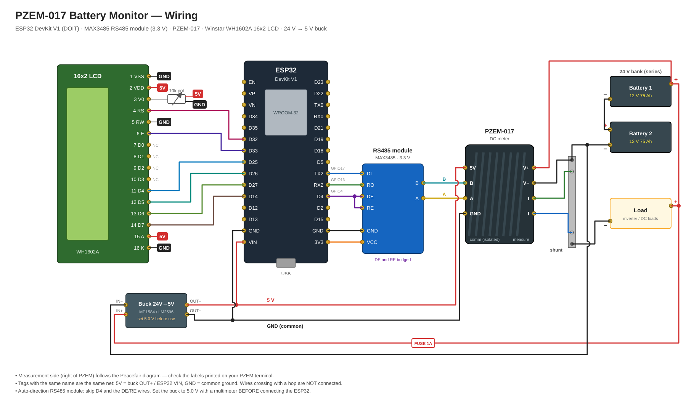
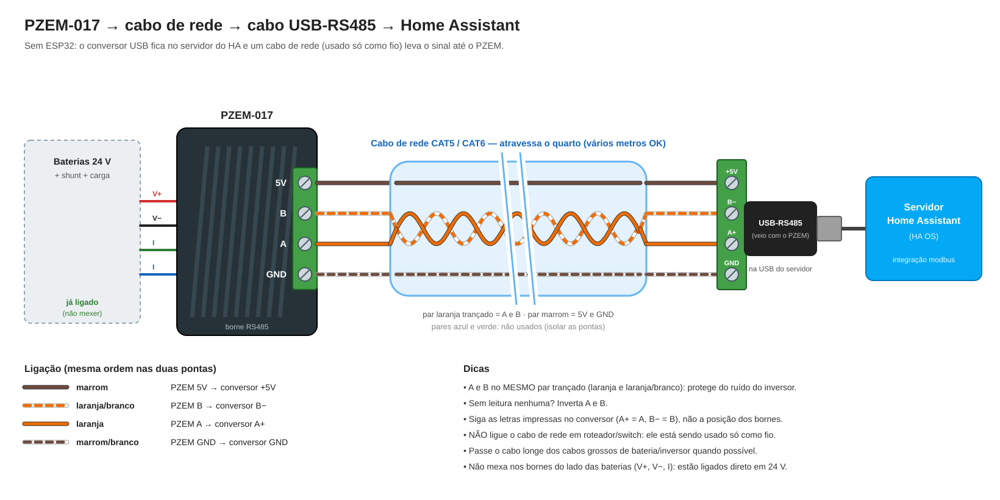

# PZEM-017 Battery Monitor (ESP32 + ESPHome + Home Assistant)

Wireless DC monitoring for a 24V battery bank (2x 12V 75Ah in series) using a
Peacefair **PZEM-017** DC meter, an **ESP32** and **ESPHome**, integrated
natively into **Home Assistant**.

```
Battery bank ── shunt ── PZEM-017 ══RS485══ MAX3485 ── ESP32 ~~WiFi~~ Home Assistant
```

## Features

- Voltage, current, power and energy (kWh) readings every 5 s
- High / low voltage alarm binary sensors
- Adjustable alarm thresholds from Home Assistant
- Shunt range selection (50 / 100 / 200 / 300 A) from Home Assistant
- Energy sensor compatible with the Home Assistant Energy dashboard
- OTA updates and encrypted native API

## Hardware

| Part | Notes |
|---|---|
| PZEM-017 + shunt | Measures 0–300 V DC, up to 300 A depending on shunt |
| ESP32 dev board | DOIT ESP32 DevKit V1 (CP2102 USB chip) |
| 16x2 LCD (optional) | Winstar WH1602A, HD44780, parallel 4-bit + 10k pot for contrast |
| RS485 module, **3.3 V** | MAX3485 or 3.3 V auto-direction module. Avoid 5 V MAX485 boards (5 V on ESP32 RX) |
| Buck converter 24 V → 5 V | MP1584 / LM2596, powers ESP32 from the bank |
| Inline fuse ~1 A | On the battery side of the buck converter |

The USB–RS485 cable shipped with the PZEM-017 is not used with the ESP32. It
is handy for bench testing from a PC.

## Wiring



PNG version: [docs/wiring.png](docs/wiring.png). Regenerate with `python docs/gen_wiring.py docs/wiring.svg`.

### Measurement side (PZEM-017 left terminal)

Follow the Peacefair diagram: shunt in series with the load's negative line,
shunt sense wires and battery voltage to the PZEM-017. With a 24 V bank the
meter's measuring side is self-powered (≥ 7 V).

### Communication side (PZEM-017 right terminal)

| ESP32 | RS485 module | PZEM-017 |
|---|---|---|
| GPIO17 (TX) | DI | — |
| GPIO16 (RX) | RO | — |
| GPIO4 | DE + RE (bridged) | — |
| 3V3 | VCC | — |
| GND | GND | — |
| — | A | A |
| — | B | B |
| 5V (VIN) | — | 5V |
| GND | — | GND |

Notes:

- The PZEM-017 RS485 side is isolated and **must** be fed 5 V on its `5V` pin.
- Using an auto-direction RS485 module? Leave GPIO4 unconnected and delete the
  `flow_control_pin` line in `battery-monitor.yaml`.
- No data / timeouts? Swap A and B first.

### LCD (optional, Winstar WH1602A 16x2)

Parallel HD44780 in 4-bit mode, write-only (RW tied to GND).

| LCD pin | Signal | Connect to |
|---|---|---|
| 1 | VSS | GND |
| 2 | VDD | 5V (VIN) |
| 3 | V0 | 10k pot wiper (pot ends to 5V and GND) |
| 4 | RS | GPIO32 (D32) |
| 5 | RW | GND |
| 6 | E | GPIO33 (D33) |
| 7–10 | D0–D3 | not connected |
| 11 | D4 | GPIO25 (D25) |
| 12 | D5 | GPIO26 (D26) |
| 13 | D6 | GPIO27 (D27) |
| 14 | D7 | GPIO14 (D14) |
| 15 | A (backlight +) | 5V |
| 16 | K (backlight −) | GND |

Shows `Voltage Current` on line 1 and `Power Energy` on line 2.
Blank screen with backlight on: turn the contrast pot.

### Power

```
Battery + ── fuse 1A ── buck IN+      buck OUT+ (5V) ── ESP32 5V/VIN
Battery − ───────────── buck IN−      buck OUT−      ── ESP32 GND
```

## Software setup

1. Install the **ESPHome** add-on in Home Assistant (or ESPHome CLI / builder).
2. Create `secrets.yaml` from `secrets.example.yaml` and fill in your values.
   Generate the API key at <https://esphome.io/components/api.html>.
3. Add `battery-monitor.yaml` as a new device in ESPHome.
4. First flash over USB. On Windows install the
   [Silicon Labs CP210x VCP driver](https://www.silabs.com/developers/usb-to-uart-bridge-vcp-drivers)
   first, then:
   ```bash
   python -m venv .venv
   .venv/Scripts/pip install esphome
   .venv/Scripts/esphome run battery-monitor.yaml --device COMx
   ```
   Stuck on `Connecting...`? Put the board in download mode: hold **BOOT**,
   tap **EN**, release **BOOT**, then retry.
   Later updates go over the air (see [OTA updates](#ota-updates)).
5. In Home Assistant: **Settings → Devices & services → ESPHome → Configure**.
6. Open the device and set **Shunt Range** to your shunt's rated current.
7. Optional: add **Battery Energy** to the Energy dashboard.

## OTA updates

Give the ESP32 a fixed IP in your router (DHCP static mapping on its MAC),
then copy `.env.example` to `.env` and set `ESP_IP`.

Flash over WiFi:

```bash
.venv/Scripts/esphome run battery-monitor.yaml --device <ESP_IP>
```

Or read the IP from `.env` (PowerShell):

```powershell
$ip = (Get-Content .env | Select-String '^ESP_IP=').Line.Split('=')[1]
.venv\Scripts\esphome run battery-monitor.yaml --device $ip
```

Run builds from PowerShell or cmd, not Git Bash: ESP-IDF refuses MSYS shells.

## Entities

| Entity | Type | Unit |
|---|---|---|
| Battery Voltage | sensor | V |
| Battery Current | sensor | A |
| Battery Power | sensor | W |
| Battery Energy | sensor | kWh |
| High Voltage Alarm | binary_sensor | — |
| Low Voltage Alarm | binary_sensor | — |
| High Voltage Alarm Threshold | number (config) | V |
| Low Voltage Alarm Threshold | number (config) | V |
| Shunt Range | select (config) | — |
| WiFi Signal | sensor | dBm |

## Modbus reference (PZEM-017)

Serial: 9600 baud, 8 data bits, no parity, **2 stop bits**. Default address `0x01`.

Input registers (function `0x04`):

| Address | Value | Resolution |
|---|---|---|
| `0x0000` | Voltage | 0.01 V |
| `0x0001` | Current | 0.01 A |
| `0x0002–0x0003` | Power (low word first) | 0.1 W |
| `0x0004–0x0005` | Energy (low word first) | 1 Wh |
| `0x0006` | High voltage alarm | `0xFFFF` alarm / `0x0000` ok |
| `0x0007` | Low voltage alarm | `0xFFFF` alarm / `0x0000` ok |

Holding registers (function `0x03` read, `0x06` write):

| Address | Value |
|---|---|
| `0x0000` | High voltage alarm threshold (0.01 V) |
| `0x0001` | Low voltage alarm threshold (0.01 V) |
| `0x0002` | Modbus address (1–247) |
| `0x0003` | Current range: `0`=100 A, `1`=50 A, `2`=200 A, `3`=300 A |

## Limitations

- **Unidirectional current.** The PZEM-017 does not report negative current:
  charging reads 0 A and the energy counter only accumulates discharge. It
  cannot compute state of charge by itself. For real SoC use a bidirectional
  shunt monitor (e.g. Victron SmartShunt) or a second PZEM on the charge path.
- Voltage-based SoC for lead-acid is only meaningful at rest; voltage sags
  under load.

## Alternative: USB–RS485 cable straight to Home Assistant (no ESP32)

Uses the USB–RS485 cable bundled with the PZEM-017 and Home Assistant's
built-in `modbus` integration. No extra hardware, but no LCD and readings stop
when the HA server is off.

### Wiring



RS485 runs fine over long distances, so the USB adapter stays plugged into the
HA server and a network cable (CAT5/CAT6, used as plain wire, not plugged into
any switch) runs to the PZEM:

| PZEM-017 | CAT5 wire (suggestion) | USB–RS485 adapter |
|---|---|---|
| A | orange | A |
| B | orange/white | B |
| 5V | brown | 5V |
| GND | brown/white | GND |

Keep A and B on the **same twisted pair** — it rejects noise from the inverter.
If nothing reads at all, swap A and B.

### Home Assistant config

1. Copy `homeassistant/pzem017_modbus.yaml` next to `configuration.yaml`.
2. Add to `configuration.yaml`:
   ```yaml
   modbus: !include pzem017_modbus.yaml
   ```
3. Set `port:` to the adapter's `/dev/serial/by-id/...` path
   (Settings → System → Hardware → All hardware).
   - HA in a VM: pass the USB device through to the VM first.
   - HA in Docker: map the device into the container (`--device`).
4. Restart Home Assistant.

The shunt range is shown read-only as `PZEM Shunt Range Code`
(0=100 A, 1=50 A, 2=200 A, 3=300 A). To change it, call the
`modbus.write_register` action with `hub: pzem017`, `slave: 1`,
`address: 3`, `value: <code>`.

## Files

| File | Purpose |
|---|---|
| `battery-monitor.yaml` | ESPHome device configuration |
| `secrets.example.yaml` | Template for `secrets.yaml` (placeholders only) |
| `.env.example` | Template for `.env` (`ESP_IP` for OTA updates) |
| `docs/wiring.svg` / `.png` | Wiring diagram |
| `docs/gen_wiring.py` | Script that generates the diagram |
| `docs/wiring-usb-cable.svg` / `.png`, `docs/gen_wiring_usb.py` | Diagram for the USB-RS485 cable option and its generator |
| `homeassistant/pzem017_modbus.yaml` | HA `modbus` config for the USB–RS485 cable option |
| `README.md` | This document |
